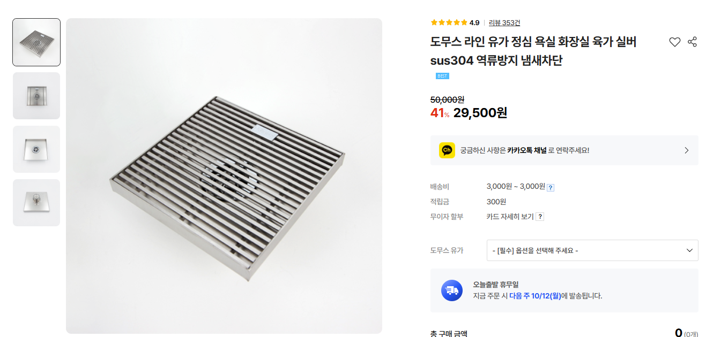

## 광교 오드카운티 45평 인테리어

기준일: **2026-10-25**

## 1. 프로젝트 기본

| 항목 | 상태 | 내용 |
|---|---|---|
| 대상 | ✅ | 광교 오드카운티 45평 |
| 시공사 | ✅ | 더패키지 |
| 담당 | ✅ | 최현철 과장 |

개인정보는 저장소에 기록하지 않는다.

### 공통 공사 / 진행
- 🧾 공사 신고 및 동의서
- 🧾 엘리베이터 / 로비 보양
- 🧾 폐기물 처리
- 🧾 입주청소
- 🧾 공사 마감

### 견적 결제 조건
- 🧾 계약금 10%: 계약 시
- 🧾 착수금 40%: 공사 일주일 전
- 🧾 중도금 45%: 타일 완료 시
- 🧾 잔금 5%: 입주청소일

---

## 2. 전체 마감

### 바닥
- ✅ 기존 마루 45평 철거 **(완료)** + 바닥 샌딩
- ✅ **LX Z:IN 에디톤 스톤 솔티 애쉬 (EDT-7724)** 확정

- 🧾 견적: LX 에디톤 45평, 7,200,000원

### 벽지
- ✅ 거실: **LX Z:IN 디아망 회벽/크림 (PR002-11)** 확정

- ✅ 서재방: **디아망 어두운 회색 벽지**

### 몰딩 / 걸레받이
- ✅ 기존 천장몰딩 / 걸레받이 철거 **(완료)**
- 🧾 천장 2.5cm 계단몰딩
- 🧾 걸레받이 4전 평몰딩
- 🟡 프로젝트에서 걸레받이/몰딩 제거 또는 최소화 방향을 검토함
- ⚠️ 무몰딩 또는 축소 시공 의도와 현재 견적 항목이 맞는지 최종 확인 필요

### 수납
- ✅ 한샘 안방 **시그니처 인피니 화이트 붙박이장**

- ✅ 안방 팬트리 **행거 설치 (과장님 서비스)**

---

## 3. 현관

- ✅ 기존 신발장 철거 **(완료)**
- ✅ 기존 현관 바닥 타일 철거 **(완료)**
- ✅ 바닥재: **LX Z:IN 에디톤 스톤 솔티 애쉬 (EDT-7724)** 확정

- ✅ 현관 벽 타일: **1200 사이즈**(⚠️1200 타일 확정인지)
- ✅ 줄눈: **케라폭시**
- 🧾 견적은 현관 바닥 타일을 **600×600**으로 반영
- 🧾 한샘 행잉형 신발장
- 🧾 현관 팬트리 가벽 및 팬트리 도어
- ✅ 중문: **문다소 리버서블도어** 최종 선정 (원슬라이딩처럼 보이는 슬림 프레임 디자인 지향)
  - ✅ 유리: **모루세로결 5T**
  - ✅ 도어 디자인: **아트 타입 (고시 없음)**
  - ✅ 손잡이: **화이트**
  - ✅ 쫄대(유리 몰딩): **화이트**
  - ✅ 도어 컬러: **132 샴페인골드**
  - ⬜ 편개/비대칭 구성 및 설치 치수·개폐 간섭은 현장 실측 확인 필요
- 참고 제품: [문다소 리버서블도어](https://naver.me/IIDy0amL)
- ✅ 도어락: **신규 미적용, 견적에서 제외**
- ✅ 기존 도어락을 분리한 뒤 **시트지 점착 후 기존 도어락 재장착**
- ✅ 현관문: **말발굽형이 아닌 디자인 도어 스토퍼 설치 (과장님 서비스)**

---

## 4. 서비스 창고

- ✅ 내부 상부는 **유효 높이를 가능한 한 최대한 확보**
- ✅ 내부 바닥은 **시공 가능한 범위 내에서 최대한 낮게 조성**
- ✅ 문턱에서 내부 바닥까지의 단차는 **경사로 방식으로 자연스럽게 연결**
- ✅ 내부를 통과하는 기존 관로 구간은 **철거 불가, 현 상태 유지**
- ✅ 전면 전체를 문짝으로 구성하는 방식은 적용하지 않고, **한쪽 구간에만 단일 도어를 설치하는 방식으로 마감**

---

## 5. 거실

- ✅ 기존 우물천장 날개 철거 **(완료)**
- ✅ 기존 아트월 타일 철거 **(완료)**
- ✅ 바닥: **LX Z:IN 에디톤 스톤 솔티 애쉬**
- ✅ 벽지: **LX Z:IN 디아망 회벽크림**
- ✅ 실링팬: **루씨에어 레이더3 실링팬 크롬다크코코아**

- 제품정보: [링크클릭](https://visrova.com/product/%EB%A3%A8%EC%94%A8%EC%97%90%EC%96%B4-%EB%A0%88%EC%9D%B4%EB%8D%943-%EC%8B%A4%EB%A7%81%ED%8C%AC-132cm-%ED%81%AC%EB%A1%AC%EB%8B%A4%ED%81%AC%EC%BD%94%EC%BD%94%EC%95%84-%EC%B2%9C%EC%9E%A5%ED%98%95-%EC%84%A0%ED%92%8D%EA%B8%B0/1822/?srsltid=AU7gw4XHSdVUDoSz20wggPCgT1RwYrq8zlZxd0l6SB-1cJeyEfl-Elms)

- ✅ 우물천장: **코너만 원형 처리**

---

## 6. 주방

### 철거 / 설비
- ✅ 기존 주방 철거 **(완료)**
- ✅ 기존 가스배관 철거 **(완료)**

### 배치
- ✅ **쿡탑/인덕션은 아일랜드에 설치하지 않음**
- ✅ **아일랜드 거실에서 주방을 봤을때 우측**
- 🧾 비스포크 키친핏 냉장고장으로 반영

- ✅ 아일랜드 상판: **세라톤 A-07 로얄 베이지** 확정

- ✅ 주방 벽 타일: **1200 사이즈** 방향
- ⚠️ 견적은 주방 벽 타일 600×600으로 되어 있어 수정/범위 확인 필요

### 싱크 / 수전
- ✅ **한샘 무선 풋터치 절수페달 HRD-HS200WL/C** 사용 방향

- 참고: [링크클릭](https://prod.danawa.com/info/?pcode=104238896)
- 🧾 라우체 피오 수전

- ✅ 싱크볼: **한샘 소르젠테 사각싱크볼 CSQ84E** 확정

- 한샘 공식 제품: [소르젠테 84 싱크볼(CSQ84E)](https://store.hanssem.com/goods/1139923)
- 이미지 출처: [한샘 소르젠테 CSQ84E 적용 시공사례](https://contents.ohou.se/projects/190285)

### 인덕션 / 후드
- ✅ **설치 위치는 기존 좌측 구석에서 우측 구석으로 이동하기로 결정**
- 사유: 기존 좌측 구석은 **코너장과 간섭**
- ✅ **하단부 수도계량기 위치를 싱크볼 밑으로 변경 (45만원)**
- ✅ 견적에는 '한샘일체형쿡탑'이 들어가 있으나 **최종적으로 제외하고 해당 금액 제외 처리하였음**
- 🧾 인덕션 단독 배선 신설 250,000원 반영

#### 인덕션 — 확정
- ✅ **삼성 NZ63DG403CFK** 확정
- ✅ 구매가: **599,000원 (삼성전자 패밀리넷)**
- ✅ 주문접수: **2026-10-19**

- 공식 제품: [삼성전자 NZ63DG403CFK](https://www.samsung.com/sec/electric-range/cooktop-nz63dg403cfk-d2c/NZ63DG403CFK/)
- 상판: **블랙 / SCHOTT Ceramic Glass / 프레임리스**
- 화구: **3구 (3 싱글)** / **DNC 간섭소음절감**
- 전체 출력: **3.4kW**
- 부스터: **3개**
  - 좌측 앞: **178mm / 1.8kW / Max 2.6kW**
  - 좌측 뒤: **152mm / 1.2kW / Max 1.5kW**
  - 우측: **208mm / 2.2kW / Max 3.4kW**
- 동시 사용: **3구 동시 사용 가능**, 2개 이상 사용 시 **전체 3.4kW 범위 내 자동 출력 배분**
- 조작: **터치 / LED**
- 전원: **220V 60Hz / 소비전력 3,400W / 플러그식**
- 스마트: **Wi-Fi 내장 / SmartThings 지원**
- 에너지소비효율: **1등급**
- 제품 크기: **600 × 520 × 48mm (W × D × H)**
- 빌트인 타공: **560 × 480mm (W × D)**
- 제조사 / 제조국: **삼성전자 / 태국**
- 출시: **2024년 3월**

---

## 7. 공용 욕실

- ✅ 세면 수전: **아메리칸스탠다드 리비어 원홀 세면수전**
  - 모델명: **FA1614-0KAKA11AA**
  - 마감: **무광 니켈 / 사틴 헤어라인**
  - 제품 링크: [링크클릭](https://m.e-nuovo.co.kr/product/detail.html?product_no=5872&cate_no=231&display_group=1)

- ✅ 샤워/욕조 수전: **비반트 CA600 BS 니켈 샤워 욕조 수전**
  - 모델명: **CA600 BS**
  - 마감: **니켈**
  - 제품 링크: [링크클릭](https://m.e-nuovo.co.kr/product/detail.html?product_no=7516&cate_no=26&display_group=1)

- ✅ 샤워부 슬라이드바: **[비반트] S-TB307 MS 니켈 사각 슬라이드바**
  - 모델명: **S-TB307 MS**
  - 수량: **1개**
  - 제품 링크: [링크클릭](https://m.e-nuovo.co.kr/product/%EB%B9%84%EB%B0%98%ED%8A%B8-s-tb307-ms-%EB%8B%88%EC%BC%88-%EC%82%AC%EA%B0%81-%EC%8A%AC%EB%9D%BC%EC%9D%B4%EB%93%9C%EB%B0%94/6314/#none)

- ✅ 세면기: **아메리칸스탠다드 PLAT 플랫 반다리 일체형 세면기**
  - 품번: **CCASF516**
  - 치수: **L455 × W545 × H410**
  - 공식 제품: [링크클릭](https://www.americanstandard.co.kr/main/product.do?proc_type=view&v_product=43&v_cate1=3&v_cate2=16)

- ✅ 양변기: **아메리칸스탠다드 SIGNATURE 2PC 시그니처 림리스 투피스 양변기**
  - 세트 품번: **CCAS3880-1100410K0**
  - 하부: **CCAS3880**
  - 탱크: **CCAS4880**
  - 시공치수: **305mm**
  - 공식 제품: [링크클릭](https://www.americanstandard.co.kr/main/product.do?proc_type=view&v_cate1=1&v_cate2=11&v_product=428)

- ✅ 욕실건 설치 **(과장님 서비스)**

- ✅ 수건걸이: **아메리칸스탠다드 플랫**
  - 모델명: **FH1051-0KAK460AH**
  - 마감: **사틴 헤어라인**
  - 길이: **600mm**
  - 제품 링크: [링크클릭](https://m.e-nuovo.co.kr/product/detail.html?product_no=5526&cate_no=27&display_group=1)

- ✅ 휴지걸이: **[아메리칸스탠다드] 액티브 휴지걸이 FH1058-0GAK450AW**
  - 제품 링크: [링크클릭](https://ypspace.co.kr/product/d33b5aad-902d-4618-8aca-d7d7f0a77fa6)

- ✅ 현관 + 공용욕실 + 안방욕실 **케라폭시 줄눈 추가 옵션: 2,000,000원**
- ✅ **전체 철거** **(완료)**
- ✅ **2차 방수**
- ✅ 배수: **라인유가**

- 🧾 폼세라믹 50T FULL 파티션
- ✅ 샤워부스 단차: **1cm**

- 🧾 600×600 타일
- ✅ 줄눈: **케라폭시**
- ✅ 휴젠트 노바

- ⬜ 라인유가 사양: SUS304, 탈착 거름망, 트랩 접근성, 배수관 규격 등 확인 필요

---

## 8. 안방 욕실

- ✅ 세면 수전: **아메리칸스탠다드 리비어 원홀 세면수전**
  - 모델명: **FA1614-0KAKA11AA**
  - 마감: **무광 니켈 / 사틴 헤어라인**
  - 적용: **공용 욕실과 동일 제품**
  - 제품 링크: [링크클릭](https://m.e-nuovo.co.kr/product/detail.html?product_no=5872&cate_no=231&display_group=1)

- ✅ 욕조부 수전: **에떼르노 E8-1005NBM 니켈 샤워욕조수전**
  - 모델명: **E8-1005NBM**
  - 마감: **니켈**
  - 적용 위치: **안방 욕실 욕조부**
  - 제품 링크: [링크클릭](https://m.e-nuovo.co.kr/product/detail.html?product_no=7297&cate_no=26&display_group=1)

- ✅ 욕조부 슬라이드바: **[비반트] S-TB307 MS 니켈 사각 슬라이드바**
  - 모델명: **S-TB307 MS**
  - 수량: **1개**
  - 제품 링크: [링크클릭](https://m.e-nuovo.co.kr/product/%EB%B9%84%EB%B0%98%ED%8A%B8-s-tb307-ms-%EB%8B%88%EC%BC%88-%EC%82%AC%EA%B0%81-%EC%8A%AC%EB%9D%BC%EC%9D%B4%EB%93%9C%EB%B0%94/6314/#none)

- ✅ 샤워 수전: **에떼르노 E8-1005NBM 니켈 샤워욕조수전**
  - 모델명: **E8-1005NBM**
  - 마감: **니켈**
  - 적용 위치: **안방 욕실 샤워부**
  - 제품 링크: [링크클릭](https://m.e-nuovo.co.kr/product/detail.html?product_no=7297&cate_no=26&display_group=1)

- ✅ 샤워부 슬라이드바: **[비반트] S-TB307 MS 니켈 사각 슬라이드바**
  - 모델명: **S-TB307 MS**
  - 수량: **1개**
  - 제품 링크: [링크클릭](https://m.e-nuovo.co.kr/product/%EB%B9%84%EB%B0%98%ED%8A%B8-s-tb307-ms-%EB%8B%88%EC%BC%88-%EC%82%AC%EA%B0%81-%EC%8A%AC%EB%9D%BC%EC%9D%B4%EB%93%9C%EB%B0%94/6314/#none)

- ✅ 세면기: **아메리칸스탠다드 PLAT 플랫 반다리 일체형 세면기**
  - 품번: **CCASF516**
  - 치수: **L455 × W545 × H410**
  - 공식 제품: [링크클릭](https://www.americanstandard.co.kr/main/product.do?proc_type=view&v_product=43&v_cate1=3&v_cate2=16)

- ✅ 양변기: **아메리칸스탠다드 SIGNATURE 2PC 시그니처 림리스 투피스 양변기**
  - 세트 품번: **CCAS3880-1100410K0**
  - 하부: **CCAS3880**
  - 탱크: **CCAS4880**
  - 시공치수: **305mm**
  - 공식 제품: [링크클릭](https://www.americanstandard.co.kr/main/product.do?proc_type=view&v_cate1=1&v_cate2=11&v_product=428)

- ✅ 욕실건 설치 **(과장님 서비스)**

- ✅ 수건걸이: **아메리칸스탠다드 플랫**
  - 모델명: **FH1051-0KAK460AH**
  - 마감: **사틴 헤어라인**
  - 길이: **600mm**
  - 제품 링크: [링크클릭](https://m.e-nuovo.co.kr/product/detail.html?product_no=5526&cate_no=27&display_group=1)

- ✅ 휴지걸이: **[아메리칸스탠다드] 액티브 휴지걸이 FH1058-0GAK450AW**
  - 제품 링크: [링크클릭](https://ypspace.co.kr/product/d33b5aad-902d-4618-8aca-d7d7f0a77fa6)

- ✅ **전체 철거** **(완료)**
- ✅ **2차 방수**
- 🟡 타일: **팀세라믹 605번** 현재 후보
- 목표: 호텔 느낌
- 공식 제품 링크: **TBD**
- 🧾 욕조부 숏 젠다이 시공
- ✅ 폼세라믹 **FULL 파티션** (80T)
- ✅ 샤워부스 단차: **1cm**

- 🧾 600×600 타일
- ✅ 줄눈: **케라폭시**
- 🧾 휴젠트 노바 추가

- 📐 욕실 치수 메모: **변기쪽 실제 공간 1500mm**

---

## 9. 도어 / 손잡이 / 중문 / 도어락

- ✅ 기존 중문 철거 **(완료)**
- 🧾 방화문 액세서리
- ✅ 방문 손잡이: **도무스 511 니켈 무광**

- 검색상 모델 표기: **511NI**
- 참고: [링크클릭](https://ohou.se/productions/feed?query=%EB%8F%84%EB%AC%B4%EC%8A%A4511&type=store)
- 🧾 욕실용 ABS 도어 2개
- ✅ 중문: **문다소 리버서블도어** 확정 (슬라이딩이 아닌 양방향 회전 스윙 방식)
  - ✅ **모루세로결 5T / 아트 타입 (고시 없음) / 화이트 손잡이 / 화이트 쫄대 / 도어 컬러 132 샴페인골드**
  - ⬜ 편개/비대칭 구성, 설치 치수 및 개폐 간섭 실측 확인 필요
- 참고: [문다소 리버서블도어](https://naver.me/IIDy0amL)
- ✅ 도어락은 **신규 미적용 / 견적 제외**
- ✅ 기존 도어락 탈거 → 시트지 점착 → 기존 도어락 재장착
- ✅ 각 방문: **말발굽형이 아닌 디자인 도어 스토퍼 설치 (과장님 서비스)**

---

## 10. 창호 / 필름

- ✅ **창호 교체 안 함**
- ✅ 기존 샷시 재사용 + **실내측 프레임 필름 시공**
- ✅ 주방 필름: **한샘 ST815 브러쉬 오트크림** 확정

- 🧾 현관문
- 🧾 현관 창문
- 🧾 거실 이중창 필름
- 🧾 기타 이중창/단창/소창 필름
- 🧾 문틀/문선/인방
- 🧾 방문 도어
- 🧾 안방 파우더장
- 🧾 두번째방 붙박이장

⚠️ 실제 창 개수와 견적 수량이 현장 실측과 일치하는지 확인.

---

## 11. 전기 / 조명 / 스위치

- ✅ 기존 전체 조명 철거 **(완료)**
- 🧾 기초 전기 배선
- 🧾 **르그랑 아펠라** 스위치/콘센트

- 🧾 2~3인치 다운라이트 60개
- ✅ 거실 다운라이트: **칸트라이팅 K9-55 NICKEL**

- 🧾 화재감지기, 발코니 직부등, 기타 센서/스피커/가스경보기
- 🧾 인덕션 단독 배선
- 🟡 거실 스위치는 벽 코너 쪽 배치를 검토
- ⬜ **주방 스위치 위치** 최종 결정 필요
- ⬜ 콘센트/스위치 전체 배치도 확정 필요

## 12. 시스템에어컨

### 실내기 구성
- ✅ 거실: **58.5㎡ × 1대**
- ✅ 서재: **26㎡ × 1대**
- ✅ 주방: **18.7㎡ × 1대**
- ✅ 안방: **18.7㎡ × 1대**
- ✅ 방2: **18.7㎡ × 1대**
- ✅ 방3: **18.7㎡ × 1대**
- ✅ 총 **실내기 6대**

### 모델 / 사양
- ✅ 모델명: **AJ072BN1PBC1**

- ✅ 정격냉방: **7.2kW**
- ✅ 운전 전류: **0.35A**

### 전기 / 실외기
- ✅ 기존 차단기: **40A**
- ⬜ 실외기 구성 및 최종 용량 확인 필요 **(패밀리넷/완)**
- ⬜ 전원 증설 필요 여부 및 동시부하 검토 필요 **(패밀리넷/완)**
- 🧾 2026-09-21 견적서에는 시스템에어컨 비용이 공란

---

## 13. 방통 / 설비

- 🧾 발코니 수전
- 🧾 배수구 유가
- 🧾 수동 빨래건조대
- ✅ 욕실 전체 철거 **(완료)** / 방수 공사 진행 방향
